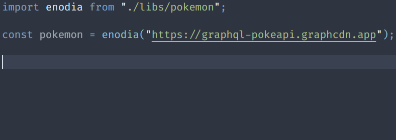

# Enodia

Enodia is a GraphQL client and server generator for Typescript projects. It
generates fully typed client and server files from your GraphQL schema, allowing
you to have automatic types in return of your queries and mutations, type safety
when providing arguments and fields, and a fully typed server to ensure your
resolvers return the expected values.



## Installation

As Enodia is needed only to generate the files, you can install it as a dev
dependency:

```bash
npm install -D enodia
```

Finally, you will need to setup an `enodia.config.ts` file at the root of your
project. Wrap your configuration with `defineConfig` to get autocompletion and
type checking:

```typescript
import { defineConfig, scalar } from "enodia";

export default defineConfig({
  // This is either the path to your graphql schema, or the URL where your API runs
  schema: "./src/graphql.schema",
  // If you only want to generate the server side, you can omit this
  client: {
    // This is the path where you want the client to be generated
    path: "./src/web/enodia.ts",
  },
  server: {
    // This is the path where you want the server to be generated
    path: "./src/server/enodia.ts",
  },
  // If you use custom scalars, you have to define them here
  scalars: {
    // Map each custom scalar in your GraphQL schema to a Typescript type with
    // `scalar<YourType>()`. For example, a `Date` scalar mapped to `Date`:
    Date: scalar<Date>(),
  },
});
```

More information on this file in the [configuration section](#configuration).

## Usage

### Generating the client

Once your `enodia.config.ts` file is setup, you can simply run Enodia:

```bash
npx enodia
```

This will generate a client and a server file at the given paths. You should
.gitignore the generated file.

### Using the client

The generated file exports a simple `enodia` function, which takes the URL of
your API as a first parameter. The second parameter is a configuration object,
allowing you to inject a custom `fetch` function. This can be used to handle
authentication, for example. This function will return the instantiated client.
The client has two properties, `query` and `mutation` containing functions to
call every query and mutation your GraphQL API exposes.

#### Unions

Fields returning a union are selected with a `$on` object keyed by the member
type names. `__typename` can be selected directly and is used to discriminate
the result:

```typescript
const feed = await client.query.feed([
  "__typename",
  {
    $on: {
      Post: ["id", "content"],
      Comment: ["id", { author: ["name"] }],
    },
  },
]);

feed.forEach((item) => {
  if (item.__typename === "Post") {
    // item is narrowed to the Post selection here
    console.log(item.content);
  }
});
```

On the server, resolvers for a union-typed field must return the matching member
tagged with its `__typename` so the server can resolve the concrete type.

## Configuration

### `schema`

Enodia needs a GraphQL schema definition to generate the client and server. You
can either point to a GraphQL file:

```typescript
export default defineConfig({
  schema: "./path/to/schema.graphql",
});
```

Or provide the URL of your GraphQL API:

```typescript
export default defineConfig({
  schema: "http://localhost:3000/graphql",
});
```

Note that your API will need to be running for Enodia to generate the files.

### `client`

#### `path`

If you want to generate the client, you will need to provide its path:

```typescript
export default defineConfig({
  client: {
    path: "./path/to/client.ts",
  },
});
```

#### `react`

Enodia can also generate React hooks for each query and mutations. All you need
for it is to specify the API URL to call:

```typescript
export default defineConfig({
  client: {
    react: {
      url: "http://localhost:3000/graphql",
    },
  },
});
```

As the config file is written in Typescript, you can rely on environment
variables. Note that Enodia does not parse dotenv files by default, so you may
need to rely on the `dotenv` library.

```typescript
import "dotenv/config";
import { defineConfig } from "enodia";

export default defineConfig({
  client: {
    react: {
      url: process.env.GRAPHQL_API_ENDPOINT,
    },
  },
});
```

### `scalars`

This is a map of custom scalar types in your GraphQL schema to Typescript types.
Each scalar is declared with `scalar<YourType>()`, so Enodia has you specify the
actual type rather than defaulting to `any`. When the scalar is already valid
JSON, such as an id carried as a string, that is all you need:

```typescript
import { defineConfig, scalar } from "enodia";

export default defineConfig({
  scalars: {
    UUID: scalar<string>(),
  },
});
```

The types that need nothing more are the ones that are already valid JSON:
`string`, `number`, `boolean`, `null`, and arrays or objects built from them, at
any depth. An object whose fields are all JSON works as-is, because it serializes
and comes back as the same value:

```typescript
scalars: {
  Point: scalar<{ x: number; y: number }>(),
},
```

The check is recursive, so a single field that is not JSON, such as a `Date`,
makes the whole scalar require a codec.

A type that is not valid JSON on its own, such as a `Date`, cannot be declared
with `scalar<Date>()` alone. Enodia requires it to carry a codec, described in
[Codecs](#codecs) below, so it knows how to convert the value to and from the
wire. Importing a type for a scalar is covered there as well, since such a type
usually needs a codec anyway.

#### Codecs

A GraphQL scalar always travels over the wire as JSON, so a `Date` arrives as a
string. To turn that string back into the type you asked for, give the scalar a
codec with an `encode` and a `decode` function. `encode` turns your type into its
wire value, and `decode` turns a wire value back into your type:

```typescript
import { defineConfig, scalar } from "enodia";

export default defineConfig({
  scalars: {
    DateTime: scalar<Date, string>({
      encode: (value) => value.toISOString(),
      decode: (value) => new Date(value),
    }),
  },
});
```

The second type argument is the wire type, the shape the scalar has as JSON. It
is optional and defaults to `unknown`, but giving it lets `decode` receive a
typed `value` instead of having to cast it.

Each side then applies the codec in the direction that fits it. On the client,
responses come back as real `Date` objects, and `Date` arguments you pass are
encoded to strings before they are sent, including when they are nested inside
input objects. On the server, the same codec encodes the values your resolvers
return and decodes the arguments they receive.

The type and the codec functions are read straight from your config, so they can
rely on imports. This is the usual case, since a type worth a codec often comes
from a library:

```typescript
import { defineConfig, scalar } from "enodia";
import Decimal from "decimal.js";

export default defineConfig({
  scalars: {
    BigDecimal: scalar<Decimal, string>({
      encode: (value) => value.toString(),
      decode: (value) => new Decimal(value),
    }),
  },
});
```

Enodia replicates every import the type and its codec depend on into the
generated files, rewriting relative paths so they resolve from each generated
file's location. Because the imports are replicated instead of copied, the
generated files always reference the original, so updating it in its source
module is enough and the generated copy never goes stale.
